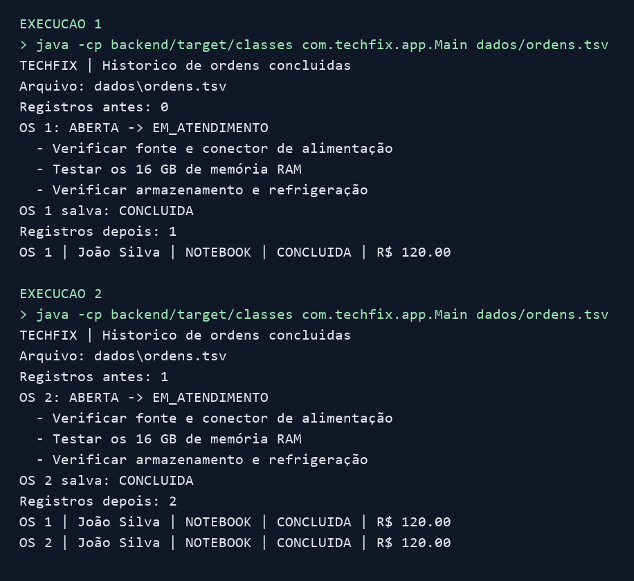

# TechFix — Sistema de Assistência Técnica

## Atividade 12 - Entrega final (`v12`)

**Link de entrega:** [versão v12 no GitHub](https://github.com/ArthurScharfenberger/TechFix-Assistencia-Tecnica/tree/v12).
**Ficha:** [PDF preenchido](docs/poo/atividade-12/Ficha_Padrao_Entrega_Atividade_12_Final.pdf) e [texto](docs/poo/atividade-12/ficha-entrega-v12.md).

O Java está organizado em três pacotes: `com.techfix.dominio` (entidades, regras, serviço, registro e contrato), `com.techfix.repositorio` (memória e arquivo) e `com.techfix.app` (montagem do cenário). A interface `RepositorioOrdens` fica no domínio e define `salvar` e `listar`; suas implementações dependem dela. Nenhuma classe de domínio importa implementações concretas. `ServicoOrdens` recebe a interface pelo construtor; `Main` escolhe o arquivo.

**Regra guardada em cada registro:** o total da ordem na conclusão é o diagnóstico de R$ 80,00 para notebook ou R$ 60,00 para desktop, somado aos itens adicionais.

`RegistroOrdem` guarda apenas número, cliente, tipo de equipamento, status e total. O arquivo TSV em UTF-8 usa `java.nio.file`. Erros de leitura e escrita são relançados como `UncheckedIOException` com mensagem e causa. O serviço só conclui ordens em atendimento, recusa números já registrados e preserva o estado quando salvar falha. O exemplo atende uma execução por vez.

Com **JDK 25 e Maven**, execute na raiz (confira o JDK usado com `java -version` e `mvn -v`):

```sh
mvn -B -f backend/pom.xml clean test
java -cp backend/target/classes com.techfix.app.Main dados/ordens.tsv
java -cp backend/target/classes com.techfix.app.Main dados/ordens.tsv
```

Se `java -version` mostrar 17, ajuste `JAVA_HOME` para a instalação do JDK 25 e coloque seu diretório `bin` no início do `PATH`. Não basta ter o JDK instalado: Maven e `java` precisam usar essa versão.

**Validação:** 31 testes JUnit aprovados, sendo 19 preservados da v11 e 12 novos. Incluem serviço com memória, recuperação por uma nova instância com `@TempDir`, preservação de dados, caracteres especiais e falhas reais de leitura/escrita. [Resultado dos testes](docs/poo/atividade-12/resultado-testes.txt).

**Duas execuções seguidas:** a primeira parte de zero e salva a OS 1; a segunda recupera a OS 1, acrescenta a OS 2 e lista ambas. O print abaixo é uma representação gráfica da [saída real de duas JVMs](docs/poo/atividade-12/saida-terminal-v12.txt), gerada em uma pasta temporária com o mesmo arquivo nas duas chamadas. Com um arquivo que já contenha registros, os números continuam a partir do histórico existente.



**UML atualizado:** [PNG](docs/poo/uml.png) e [SVG editável](docs/poo/uml.svg).


[Decisões, formato e testes](docs/poo/atividade-12/README.md) · [Guia para a microdefesa](docs/poo/atividade-12/microdefesa.md).

Trabalho desenvolvido com apoio do OpenAI Codex na implementação, nos testes e na documentação, conforme declaração da ficha. A revisão, a compreensão e o envio na plataforma Aula cabem à equipe; o material não atesta submissão já realizada.

A [entrega anterior da Atividade 11](docs/poo/atividade-11/README.md) e a [tag v11](https://github.com/ArthurScharfenberger/TechFix-Assistencia-Tecnica/tree/v11) permanecem como histórico.

O TechFix é um projeto acadêmico para organizar clientes, equipamentos, ordens de serviço, reparos e o trabalho da equipe de uma assistência técnica.

Atualmente, o repositório reúne duas partes independentes:

- um frontend em TypeScript, executado com Vite e com persistência local no navegador;
- uma atividade de Programação Orientada a Objetos em Java padrão, sem integração com o frontend.

## Funcionalidades do frontend

- autenticação local para demonstração;
- dashboard e indicadores;
- cadastros de clientes, equipamentos e equipe;
- gerenciamento de ordens de serviço e reparos;
- relatórios com filtros, paginação, exportação CSV e impressão.

### Acesso de demonstração

- Usuário: `admin` ou `admin@techfix.local`
- Senha: `admin`

Essa autenticação existe apenas para demonstração acadêmica. Como é executada no navegador, não oferece a segurança necessária para uso em produção.

## Atividade Java

A implementação Java representa clientes, técnicos, equipamentos e ordens de serviço. A AP2 reúne coleções de ordens por cliente (A6), composição de itens (A7), herança entre Equipamento, Notebook e Desktop (A8) e interface/polimorfismo de roteiros de diagnóstico (A9). `Main` demonstra o cenário integrado entre os objetos Java.

Esta etapa usa Java 25 e Maven para 31 testes JUnit, três pacotes e persistência em arquivo. Não há Spring, banco de dados ou API REST. Java e TypeScript ainda não se comunicam.

Uma visão geral da área Java está em [`backend/README.md`](backend/README.md). As instruções de compilação e a descrição das classes estão em [`backend/src/README.md`](backend/src/README.md), e o esboço da Atividade 6 está em [`docs/poo/atividade-06/atividade-semanal-06-esboco.md`](docs/poo/atividade-06/atividade-semanal-06-esboco.md).

## Diagramas

- [`docs/poo/diagrama-classes`](docs/poo/diagrama-classes/README.md): diagrama correspondente às classes Java implementadas, com atributos, métodos e multiplicidades.
- [`docs/poo/diagrama-uml`](docs/poo/diagrama-uml/README.md): registro da modelagem inicial do domínio.

## Estrutura principal

```text
TechFix/
├── backend/
│   ├── pom.xml
│   ├── README.md
│   └── src/
│       ├── README.md
│       ├── main/java/com/techfix/
│       │   ├── app/           # Main
│       │   ├── dominio/       # entidades, serviço, registro e interface
│       │   └── repositorio/   # implementações em memória e arquivo
│       └── test/java/com/techfix/
│           ├── dominio/       # 24 testes
│           └── repositorio/   # 7 testes
├── docs/
│   ├── poo/             # entregas, fichas, UML e diagramas de POO
│   ├── processos/       # entregas, dossiê, qualidade e evolução de Processos
│   └── projeto/         # planejamento inicial
├── public/
├── src/                 # frontend TypeScript
├── DEVLOG.md
├── PLANEJAMENTO.md
├── package.json
└── README.md
```

## Executando o frontend

```bash
npm install
npm run dev
```

Os scripts disponíveis e as dependências estão definidos em `package.json`.

## Documentação

A pasta `docs` reúne entregas, imagens e documentação das atividades:

Índice completo, atividade por atividade: [docs/README.md](docs/README.md).

| Pasta | Conteúdo |
| --- | --- |
| [docs/poo/](docs/poo/) | Programação Orientada a Objetos: atividades 06, 09, 11 e 12, AP2, UML e diagramas de classes. |
| [docs/processos/](docs/processos/) | Processos de Engenharia de Software: entregas A2–A10, AP2, backlog, dossiê, qualidade (A11–A13) e evolução (A14). |
| [docs/projeto/](docs/projeto/) | Planejamento inicial da assistência técnica. |

Documentação técnica: [área Java](backend/README.md), [execução e classes](backend/src/README.md), [diagrama](docs/poo/diagrama-classes/README.md), [planejamento](PLANEJAMENTO.md) e [histórico](DEVLOG.md).

## Integrante

- Arthur Scharfenberger
- Lucas Oliveira da Silva

## Entrega final de polimorfismo da Atividade 9

A interface `RoteiroDiagnostico` define etapas ordenadas e imutáveis, com implementações distintas em `Notebook` e `Desktop`, integradas à ordem de serviço. Consulte a [ficha final em PDF](docs/poo/atividade-09/Ficha_Padrao_Entrega_Atividade_09_Final.pdf).

## Escopo de atendimento

A TechFix realiza manutenção exclusivamente de notebooks e PCs (desktops). Os tipos de equipamento aceitos são `NOTEBOOK` e `DESKTOP`.

## Verificações da interface web

Para executar os testes Java durante a apresentação, use `Testar-POO.cmd` na raiz do projeto. O resultado fica visível no terminal, e o Maven roda em modo offline. São necessários JDK 25 e Maven no PATH. Antes da aula, prepare as dependências no computador da apresentação com `mvn -B -f backend/pom.xml clean test` e confira `Testar-POO.cmd --sem-pausa`. Os 31 testes de POO são separados dos cinco testes do site.

Execute `npm test` para conferir datas civis, validações de equipamentos e a sincronização do status quando há reparos simultâneos, troca de equipamento, cancelamento ou exclusão. Execute `npm run build` para verificar os tipos e gerar a versão de produção.

## Entrega AP2

- [Slides atualizados](docs/poo/apresentacao-ap2/Apresentacao-POO-TechFix.pptx).
- [Diagrama atual com multiplicidades](docs/poo/diagrama-classes/README.md) e [versão visual](docs/poo/diagrama-classes/Diagrama-AP2.svg).
- [Roteiro de Arthur e Lucas em PDF](docs/poo/apresentacao-ap2/Roteiro-Apresentacao-POO-Arthur-Lucas.pdf).
- [Registro de uso de IA na AP2](AI.md) e [histórico Java](backend/IA.md).
- [Backlog e planejamento](PLANEJAMENTO.md), com funcionalidades futuras distinguidas da implementação atual.

A versão de entrega é identificada pela tag Git `ap2`. Para a demonstração Java, execute `java -cp backend/target/classes com.techfix.app.Main` após os testes. A interface usa armazenamento local e não se comunica com o Java.

### Interface da oficina

A oficina usa cabeçalho preto, logo oficial, área branca e destaques ciano, com estilos em `src/styles/workshop.css`. Os indicadores usam dados reais: custos são custos dos reparos, abertura é a data de criação e conclusão não significa retirada do equipamento. Busca, filtros, paginação e formulários reutilizam os módulos existentes.

## AP2 — Processos de Engenharia de Software

Versão atual: [slides em PDF](docs/processos/apresentacao-ap2/TechFix-AP2.pdf), [PowerPoint editável](docs/processos/apresentacao-ap2/TechFix-AP2.pptx), [roteiro](docs/processos/apresentacao-ap2/Roteiro-Arthur-Lucas.pdf) e [ficha de entrega](docs/processos/apresentacao-ap2/Ficha-Entrega-AP2.pdf). São 13 slides, com origem na A3 e conexão entre A7–A10; exposição planejada de 11 minutos e 4 minutos para perguntas.
