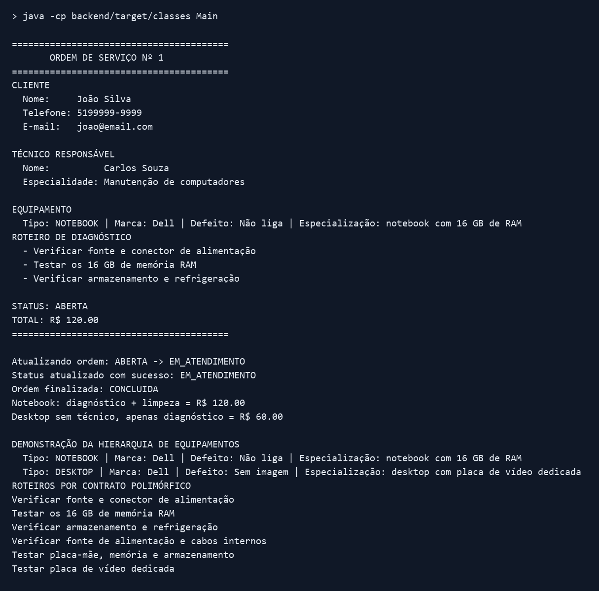

# TechFix — Sistema de Assistência Técnica

## Atividade 11 — Entrega final (`v11`)

Entrega: [versão v11 no GitHub](https://github.com/ArthurScharfenberger/TechFix-Assistencia-Tecnica/tree/v11).
Documentos: [cinco regras de negócio](docs/especificacao.md), [diagrama PNG](docs/uml.png), [SVG editável](docs/uml.svg) e [Ficha de Entrega preenchida](docs/ficha-entrega-v11.md).

O diagnóstico custa R$ 80,00 para notebook e R$ 60,00 para desktop. `PoliticasCobranca.para()` concentra a seleção por tipo, e `OrdemServico` guarda uma `PoliticaCobranca` para somar o diagnóstico aos itens adicionais. A ordem cria suas partes e expõe uma cópia não modificável da lista. O responsável técnico é opcional (`0..1`). A herança e o contrato de diagnóstico das etapas anteriores continuam no cenário integrado.

Com Java 25 e Maven instalados, execute na raiz:

```sh
mvn -f backend/pom.xml clean test
java -cp backend/target/classes Main
```

Os 19 testes incluem cinco da reciclagem: valores por tipo, soma de item adicional, lista não modificável, cópia independente e rejeição de valor negativo. `Main` abre a ordem, registra o serviço, consulta o roteiro, calcula R$ 120,00 para notebook com limpeza e conclui o atendimento; também demonstra R$ 60,00 para desktop sem técnico.

Registro gráfico gerado a partir da saída real do processo Java (também disponível como [texto](docs/saida-terminal-v11.txt)):



O apoio de OpenAI Codex incluiu código, testes e documentação. A equipe precisa revisar a entrega e treinar a explicação para a microdefesa. A publicação da tag não envia a tarefa na plataforma Aula.


O TechFix é um projeto acadêmico para organizar clientes, equipamentos, ordens de serviço, reparos e o trabalho da equipe de uma assistência técnica.

Atualmente, o repositório reúne duas partes independentes:

- um frontend em TypeScript, executado com Vite e com persistência local no navegador;
- uma atividade de Programação Orientada a Objetos em Java padrão, sem integração com o frontend.

## Funcionalidades do frontend

- autenticação local para demonstração;
- dashboard e indicadores;
- cadastros de clientes, equipamentos e equipe;
- gerenciamento de ordens de serviço e reparos;
- relatórios com filtros, paginação, exportação CSV e impressão.

### Acesso de demonstração

- Usuário: `admin` ou `admin@techfix.local`
- Senha: `admin`

Essa autenticação existe apenas para demonstração acadêmica. Como é executada no navegador, não oferece a segurança necessária para uso em produção.

## Atividade Java

A implementação Java representa clientes, técnicos, equipamentos e ordens de serviço. A AP2 reúne coleções de ordens por cliente (A6), composição de itens (A7), herança entre Equipamento, Notebook e Desktop (A8) e interface/polimorfismo de roteiros de diagnóstico (A9). `Main` demonstra o cenário integrado entre os objetos Java.

Esta etapa usa Java 25 e Maven para 19 testes JUnit. Não há Spring, banco de dados, API REST ou declarações de package. Java e TypeScript ainda não se comunicam.

Uma visão geral da área Java está em [`backend/README.md`](backend/README.md). As instruções de compilação e a descrição das classes estão em [`backend/src/README.md`](backend/src/README.md), e o esboço da Atividade 6 está em [`backend/docs/atividade-semanal-06-esboco.md`](backend/docs/atividade-semanal-06-esboco.md).

## Diagramas

- [`Diagrama-Classes`](Diagrama-Classes/README.md): diagrama correspondente às classes Java implementadas, com atributos, métodos e multiplicidades.
- [`Diagrama-UML`](Diagrama-UML/README.md): registro da modelagem inicial do domínio.

## Estrutura principal

```text
TechFix/
├── backend/
│   ├── pom.xml
│   ├── README.md
│   └── src/
│       ├── README.md
│       ├── main/java/
│       │   ├── Cliente.java
│       │   ├── Desktop.java
│       │   ├── Equipamento.java
│       │   ├── Main.java
│       │   ├── Notebook.java
│       │   ├── OrdemServico.java
│       │   ├── StatusOrdemServico.java
│       │   ├── Tecnico.java
│       │   └── TipoEquipamento.java
│       └── test/java/
│           ├── EquipamentoTest.java
│           └── OrdemServicoTest.java
├── Diagrama-Classes/
│   ├── DiagramaClasses.png
│   └── README.md
├── Diagrama-UML/
├── docs/
├── public/
├── src/                 # frontend TypeScript
├── DEVLOG.md
├── PLANEJAMENTO.md
├── package.json
└── README.md
```

## Executando o frontend

```bash
npm install
npm run dev
```

Os scripts disponíveis e as dependências estão definidos em `package.json`.

## Documentação

- [`docs/entregas-processos/README.md`](docs/entregas-processos/README.md): entregas de Processos em DOCX e PDF, modelos visuais e fontes editáveis.
- [`docs/entregas-processos/Arquitetura-Rastreabilidade-Esboco.pdf`](docs/entregas-processos/Arquitetura-Rastreabilidade-Esboco.pdf): esboço da arquitetura conceitual e matriz inicial com três requisitos rastreados; versões Word e Markdown na mesma pasta.
- [`docs/entregas-processos/A8-Entrega-Final-Revisada.md`](docs/entregas-processos/A8-Entrega-Final-Revisada.md): revisão da A8 vinculada à A5, com nove itens, dois incrementos e quatro riscos; estimativas propostas para validação da equipe.

- [`DEVLOG.md`](DEVLOG.md): histórico das alterações e verificações do projeto.
- [`PLANEJAMENTO.md`](PLANEJAMENTO.md): referência para o planejamento revisado e registro histórico da A8 original.
- [`docs/atividade-semanal-08.md`](docs/atividade-semanal-08.md): versão consultável da Atividade 08.
- [`docs/Atividade_A8.pdf`](docs/Atividade_A8.pdf): documento original entregue na Atividade 08.
- [`docs/atividade-semanal-08-poo-entrega-final.md`](docs/atividade-semanal-08-poo-entrega-final.md): implementação, demonstração, testes e justificativa da herança.
- [`docs/Apresentacao-POO-TechFix.pptx`](docs/Apresentacao-POO-TechFix.pptx): apresentação revisada de POO, com exemplos de Notebook e Desktop e mídias preservadas.
- [`docs/Roteiro-Apresentacao-POO-Arthur-Lucas.md`](docs/Roteiro-Apresentacao-POO-Arthur-Lucas.md): roteiro por apresentador e slide, planejado para aproximadamente seis minutos.
- [`backend/README.md`](backend/README.md): limites e organização da área Java.
- [`backend/src/README.md`](backend/src/README.md): documentação e execução do código Java.
- [`docs/atividade-semanal-03.md`](docs/atividade-semanal-03.md): registro da Atividade Semanal nº 3.
- [`Diagrama-Classes/README.md`](Diagrama-Classes/README.md): explicação do diagrama implementado.

## Integrante

- Arthur Scharfenberger
- Lucas Oliveira da Silva

## Entrega final de polimorfismo da Atividade 9

A interface `RoteiroDiagnostico` define etapas ordenadas e imutáveis, com implementações distintas em `Notebook` e `Desktop`, integradas à ordem de serviço. [Ficha final PDF](docs/Ficha_Padrao_Entrega_Atividade_09_Final.pdf) e [documentação](docs/atividade-semanal-09-poo-entrega-final.md). Para reproduzir o PDF: `python docs/gerar_entrega_polimorfismo.py` (requer `reportlab`).

## Escopo de atendimento

A TechFix realiza manutenção exclusivamente de notebooks e PCs (desktops). Os tipos de equipamento aceitos são `NOTEBOOK` e `DESKTOP`.

## Verificações da interface web

Para executar os testes Java durante a apresentação, use `Testar-POO.cmd` na raiz do projeto. O resultado fica visível no terminal, e o Maven roda em modo offline. Veja a [preparação para a aula](docs/Executar-Testes-Na-Apresentacao.md), incluindo os requisitos de JDK/Maven e a distinção entre os 14 testes de POO e os cinco testes do site.

Execute `npm test` para conferir datas civis, validações de equipamentos e a sincronização do status quando há reparos simultâneos, troca de equipamento, cancelamento ou exclusão. Execute `npm run build` para verificar os tipos e gerar a versão de produção.

## Entrega AP2

- [Conferência dos requisitos e demonstração](docs/Entrega-AP2.md).
- [Slides atualizados](docs/Apresentacao-POO-TechFix.pptx).
- [Diagrama atual com multiplicidades](Diagrama-Classes/README.md) e [versão visual](Diagrama-Classes/Diagrama-AP2.svg).
- [Roteiro de Arthur e Lucas](docs/Roteiro-Apresentacao-POO-Arthur-Lucas.md), também em [PDF](docs/Roteiro-Apresentacao-POO-Arthur-Lucas.pdf).
- [Registro de uso de IA na AP2](AI.md) e [histórico Java](backend/IA.md).
- [Backlog e planejamento](PLANEJAMENTO.md), com funcionalidades futuras distinguidas da implementação atual.

A versão de entrega é identificada pela tag Git `ap2`. A interface segue o [layout da oficina](docs/Interface-Oficina.md); usa armazenamento local e não se comunica com o Java.
