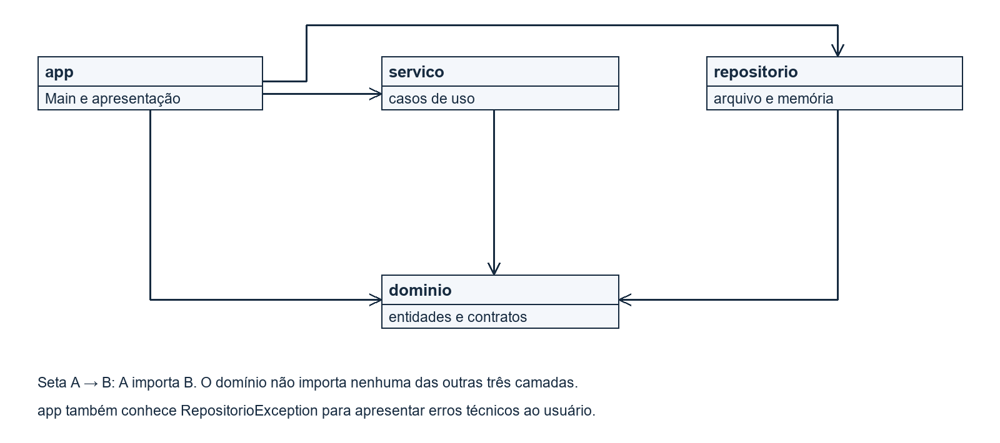
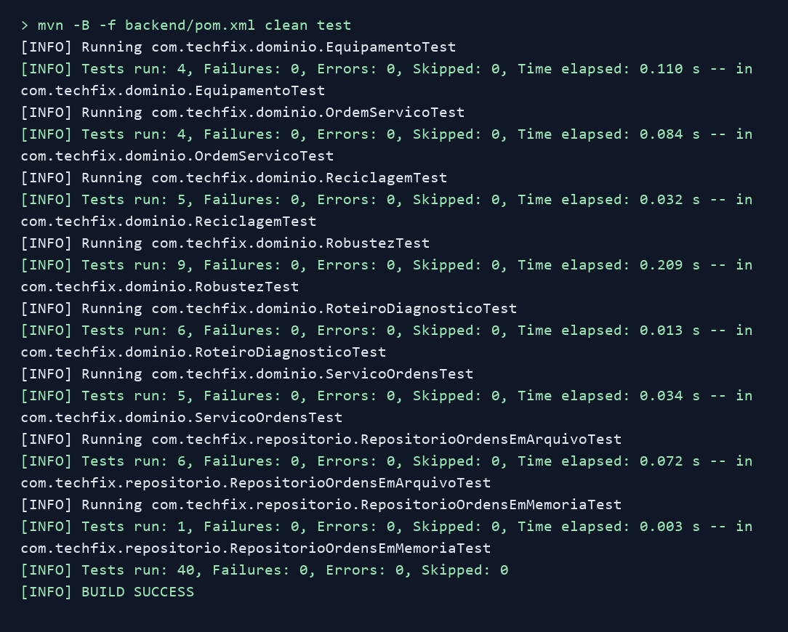
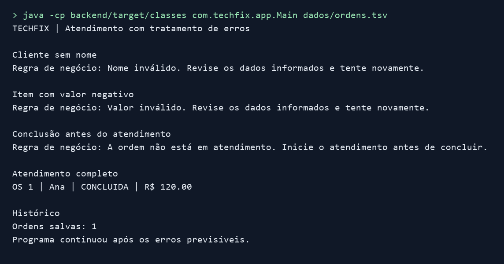
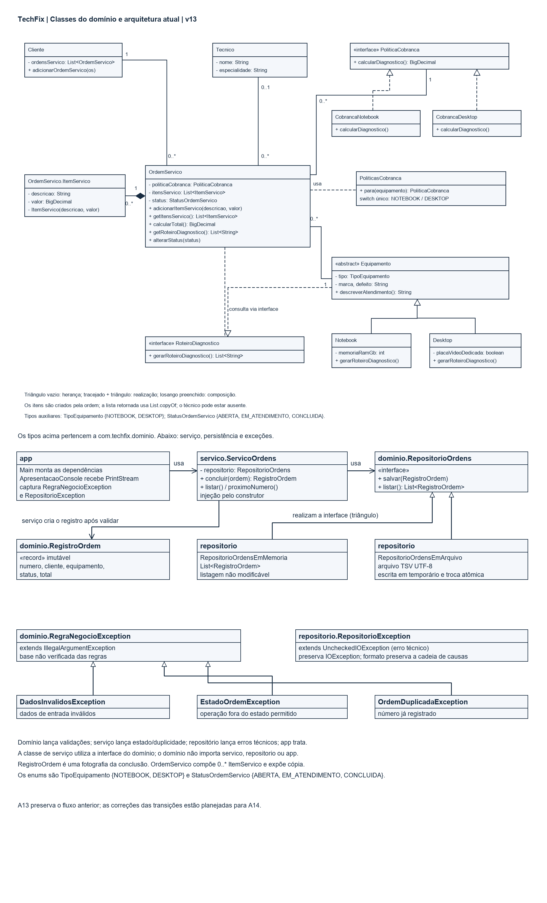

# TechFix — Assistência técnica

Projeto acadêmico de Arthur Scharfenberger e Lucas Oliveira da Silva para atendimento de notebooks e desktops. O Java de POO simula abertura, diagnóstico, serviços adicionais, conclusão e histórico persistido. A interface web é um protótipo independente com armazenamento local; não está conectada ao Java.

## Entrega atual de POO

**Atividade 13 — Robustez:** [tag v13](https://github.com/ArthurScharfenberger/TechFix-Assistencia-Tecnica/tree/v13), [ficha PDF](docs/poo/atividade-13/Ficha_Padrao_Entrega_Atividade_13_Final.pdf) e [evidências](docs/poo/atividade-13/README.md). Preparada em 23/11/2026. Não atesta envio na plataforma Aula.

A [A11](docs/poo/atividade-11/README.md) está pronta na tag `v11`. A [A10 de POO](docs/poo/atividade-10/README.md) recebeu revisão técnica; o relato real da defesa AP2 continua pendente de informação da dupla. O histórico registra as datas reais dos commits.

## Regras de negócio

- Cada ordem pertence a um cliente e um equipamento, inicia ABERTA e pode ter zero ou um técnico.
- O diagnóstico custa R$ 80,00 para notebook e R$ 60,00 para desktop; `PoliticasCobranca` seleciona a política em um único ponto.
- A ordem cria itens com descrição preenchida e valor não negativo. Sua lista é uma cópia não modificável.
- O total é diagnóstico mais itens adicionais, usando `BigDecimal`.
- O serviço conclui somente ordens EM_ATENDIMENTO, rejeita números já registrados e salva antes de mudar o estado. O registro é uma fotografia imutável da conclusão.

[Mini-especificação RN1–RN5](docs/especificacao.md). Tarifas são regras acadêmicas, não uma tabela comercial real.

## Instruções de execução

Pré-requisitos: **JDK 17 ou superior**, **Maven 3.9.x**, Git e internet na primeira execução para baixar dependências. Confira `java -version` e `mvn -version`: ambos devem usar o JDK correto. Node não é necessário para POO.

```sh
git clone https://github.com/ArthurScharfenberger/TechFix-Assistencia-Tecnica.git
cd TechFix-Assistencia-Tecnica
git checkout v13
cd backend
mvn clean test
java -Dfile.encoding=UTF-8 -cp target/classes com.techfix.app.Main
```

Na raiz do repositório, os comandos equivalentes são `mvn -f backend/pom.xml clean test` e `java -Dfile.encoding=UTF-8 -cp backend/target/classes com.techfix.app.Main`.

O cenário demonstra três erros tratados e depois conclui uma ordem de R$ 120,00. `dados/ordens.tsv` é criado relativo à pasta em que o Java foi iniciado; uma segunda execução com o mesmo arquivo salva o próximo número. Para escolher outro arquivo: `java -cp target/classes com.techfix.app.Main dados/demo.tsv`. Não apague um histórico que queira conservar.

## Estrutura de pacotes

| Pacote | Responsabilidade |
|---|---|
| `com.techfix.dominio` | Entidades, políticas, exceções de negócio, registro imutável e contrato `RepositorioOrdens` |
| `com.techfix.servico` | `ServicoOrdens`: coordena conclusão e recebe o repositório pelo construtor |
| `com.techfix.repositorio` | Implementações em memória/arquivo e `RepositorioException` |
| `com.techfix.app` | `Main` monta as peças; `ApresentacaoConsole` executa o cenário e trata erros |

O domínio não importa as outras camadas. O serviço depende do contrato do domínio, não da implementação em arquivo.



## Tratamento de erros

| Situação | Exceção | Camada que lança | Camada que trata | Mensagem ao usuário |
|---|---|---|---|---|
| Cliente sem nome | `DadosInvalidosException` | domínio | app | Nome inválido. Revise os dados informados e tente novamente. |
| Item negativo | `DadosInvalidosException` | domínio | app | Valor inválido. Revise os dados informados e tente novamente. |
| Conclusão antes do atendimento | `EstadoOrdemException` | serviço | app | A ordem não está em atendimento. Inicie o atendimento antes de concluir. |
| Número repetido | `OrdemDuplicadaException` | serviço | app | Ordem N já registrada. Abra uma ordem com outro número. |
| Falha de leitura/escrita | `RepositorioException` | repositório | app | Não foi possível ler/gravar as ordens no caminho indicado. Verifique o caminho e as permissões e tente novamente. |
| Linha inválida no arquivo | `RepositorioException` | repositório | app | Registro inválido na linha N. Corrija o arquivo ou restaure um backup antes de tentar novamente. |

As exceções são **não verificadas**: as regras estendem `RegraNegocioException` (subclasse de `IllegalArgumentException`) e a falha técnica estende `UncheckedIOException`; o serviço propaga e a apresentação trata, evitando `throws` em cada método intermediário. O repositório preserva a causa original; erros de formato mantêm a exceção de parsing na cadeia de causas.

Há `try/catch` por operação na apresentação, permitindo continuar após erro previsível. Não é necessário `finally` para `Files.readAllLines` e `Files.writeString`, que fecham seus recursos internamente. Os testes da apresentação usam `try-with-resources` para fechar o `PrintStream` injetado; não fechamos `System.out`.

O arquivo é escrito em temporário e substituído atomicamente. Se o sistema de arquivos não suportar a troca atômica, a operação falha com causa preservada; não há fallback que exponha escrita parcial. O cenário é de uma execução por vez, sem concorrência entre processos ou banco de dados.

## Testes e execução comprovada

**40 testes aprovados**, incluindo os 31 casos anteriores e 9 novos de robustez. Os casos anteriores foram preservados; a expectativa de `IllegalStateException` foi atualizada para a exceção específica de negócio. Arquivos de teste usam `@TempDir`; a apresentação recebe saída injetada.

As imagens abaixo são representações gráficas dos logs reais, geradas por `scripts/gerar-evidencias-poo.py`; não são capturas de uma janela de terminal. [Log completo](docs/poo/atividade-13/testes-v13.txt) e [duas execuções reais](docs/poo/atividade-13/saida-terminal-v13.txt).





## Diagrama de classes

O primeiro painel mostra herança, interfaces, composição e multiplicidades; o segundo detalha serviço, repositórios e exceções.



## Decisões de projeto

1. **Contexto:** há preços por tipo de equipamento. **Decisão:** uma fábrica escolhe duas implementações de `PoliticaCobranca`. **Consequência:** a ordem usa a interface e não repete condicionais por tipo.
2. **Contexto:** a persistência deve poder mudar. **Decisão:** interface no domínio e injeção pelo construtor do serviço. **Consequência:** testes usam memória; produção acadêmica usa TSV, sem acoplar entidades ao disco.
3. **Contexto:** gravação pode falhar. **Decisão:** validar e salvar antes de marcar a ordem como concluída, com substituição atômica do arquivo. **Consequência:** falha não deixa a ordem concluída sem registro; exige sistema de arquivos com movimento atômico.
4. **Contexto:** o usuário deve entender erros previsíveis. **Decisão:** exceções específicas e captura na apresentação. **Consequência:** regras ficam na origem e a mensagem explica como corrigir a entrada.

## Como o código evolui

| Tag | Incremento |
|---|---|
| `ap2` | Coleções, composição, herança e interface de roteiro |
| `v11` | Políticas de diagnóstico, composição encapsulada e 19 testes |
| `v12` | Pacotes, repositório e persistência; 31 testes |
| `v13` | Serviço separado, exceções, recuperação e 40 testes |

As tags `v11` e `v12` preservam o POM antigo de Java 25. Para verificá-las com JDK 17, use `mvn "-Dmaven.compiler.release=17" clean test`; o comando é uma sobrescrita de configuração e não altera as tags. [Declaração de IA](AI.md).

## Interface web e Processos de Engenharia de Software

O protótipo web usa TypeScript/Vite e armazenamento local. Na raiz: `npm ci`, `npm test`, `npm run dev` e `npm run build` (Node.js compatível com `package.json`). Não é necessário executá-lo para demonstrar POO.

[Índice de documentos](docs/README.md) · [dossiê AS de Processos](docs/06-evolucao/A15-dossie-e-plano-evolucao.md) · [apresentação de Processos](docs/processos/apresentacao-as/README.md) · [planejamento](PLANEJAMENTO.md) · [histórico](DEVLOG.md).

As tags `v1.0.0`, `v1.1.0` e `v2.0.0` pertencem ao dossiê de Processos; `v11` a `v14` pertencem à evolução do Java de POO. As correções do Java não significam que os defeitos equivalentes do frontend foram resolvidos.
