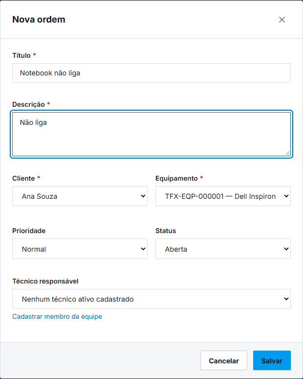
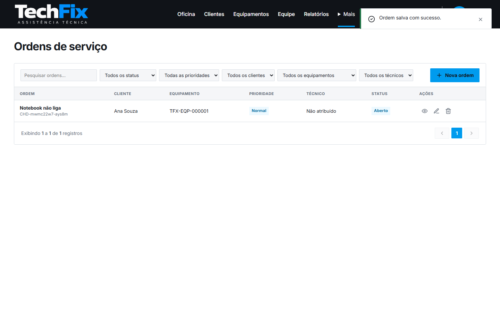
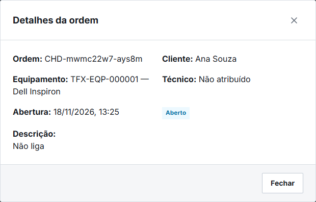
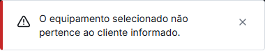

# Demonstração AS do TechFix

Capturas reais do protótipo em 18/11/2026, em navegador isolado, com massa fictícia baseada em CT03 e CT04. O site continua local. [Abrir o sistema](http://localhost:5173) ou baixar esta pasta e abrir [index.html](index.html) para percorrer as capturas sem internet. Os slides também contêm o plano B.

## 1. Abertura — HU1, RF2 Must, CA04, CT04

Ana Souza já tem o notebook **EQ-1** cadastrado. O frontend apresenta esse equipamento com o código **TFX-EQP-000001**. Defeito: **Não liga**. O atendente seleciona cliente e equipamento, mantém Aberta e técnico não atribuído e clica em Salvar.

## 2. Confirmação e consulta — HU1, RF2, CA04, CT04

A OS aparece na lista. O atendente abre os detalhes para conferir a gravação.

**Limite da demonstração:** o CT04 completo espera a OS numérica 25 após a 24 e o evento “OS aberta”. A aplicação gera um ID CHD e não demonstra esse evento. A captura comprova somente abertura e consulta locais, com Ana/EQ-1. CT04 permanece **parcial**, sem simular aprovação integral.

## 3. Caminho de erro — RF1, RF2, CA03, CT03

Entrada inválida: **Ana Souza + EQ-2**, equipamento de **Bruno Lima**. A interface filtra por cliente. Por isso, o cenário negativo chama diretamente `ChamadoService.create`, como na execução da A13. A mensagem abaixo vem da exceção real, exibida pelo componente Toast da aplicação.

Resultado: uma OS antes e uma depois da tentativa, **zero novas OS**. [Tela completa do erro](04-erro-vinculo.png). Essa checagem do serviço não representa uma seleção inválida permitida pela interface.

## Evidências e limites

- [Casos A13](../../processos/05-qualidade/A13-estrategia-e-casos-de-teste.md), [matriz](../../processos/dossie/matriz-rastreabilidade.md) e [requisitos](../../processos/dossie/requisitos.md).
- Site com localStorage, sem API integrada ao Java. Login demonstrativo: `admin` / `admin`.
- Garantia RN2 especificada, ainda sem implementação. O plano de evolução mantém as dívidas abertas.
- Apoio de OpenAI Codex na captura, organização e redação, registrado no DEVLOG e na ficha AS. As telas são do aplicativo existente.
