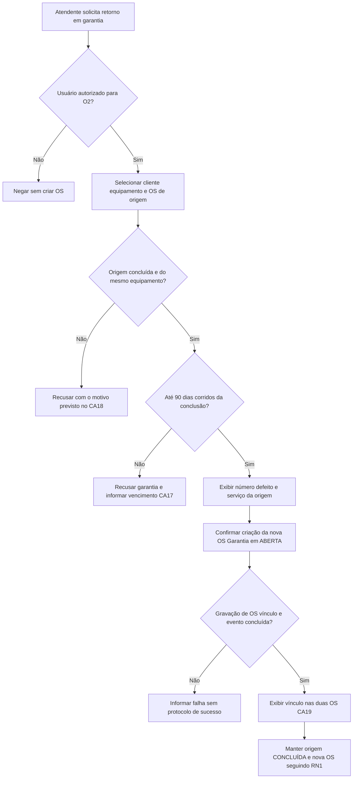

# Fluxo planejado de retorno em garantia do TechFix

Complemento da A9 na versão final AS. IDs: SM-01, RN2, RF2, RF3, CA16–CA19, CT19–CT22, A8R10. Este modelo descreve comportamento a implementar, não uma tela disponível.

O 90º dia é aceito (CT19); o 91º é recusado (CT20). Estado e equipamento inválidos são cobertos por CT21; consulta bidirecional, por CT22. C2 valida e C4 grava; C1 apresenta; C3 autoriza. A confirmação técnica da garantia continua adiada em A8R12. Refinar o wireframe com o campo OS de origem antes de implementar A8R10 (DIV06).
